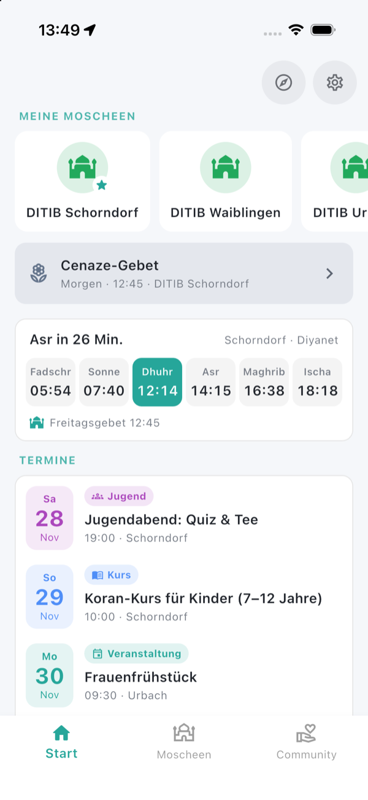
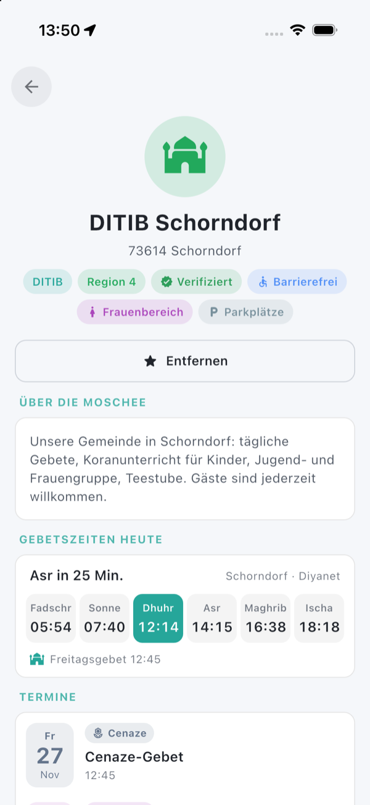
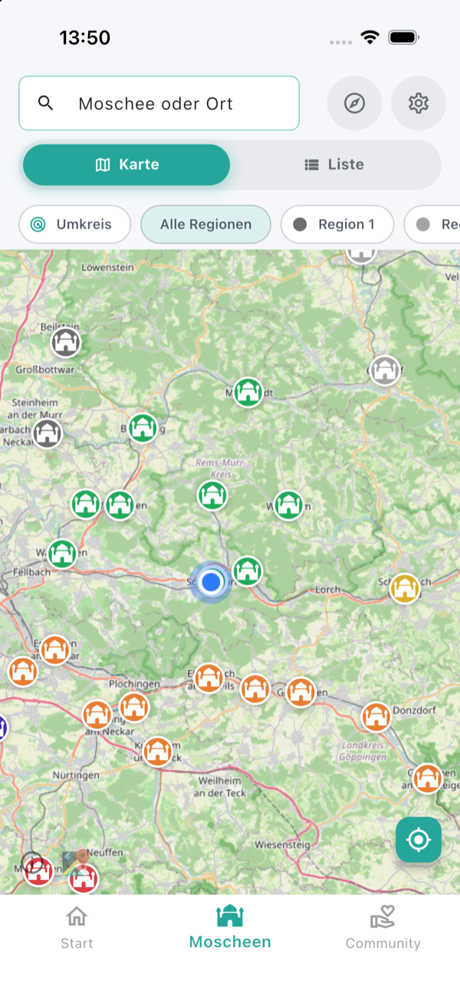
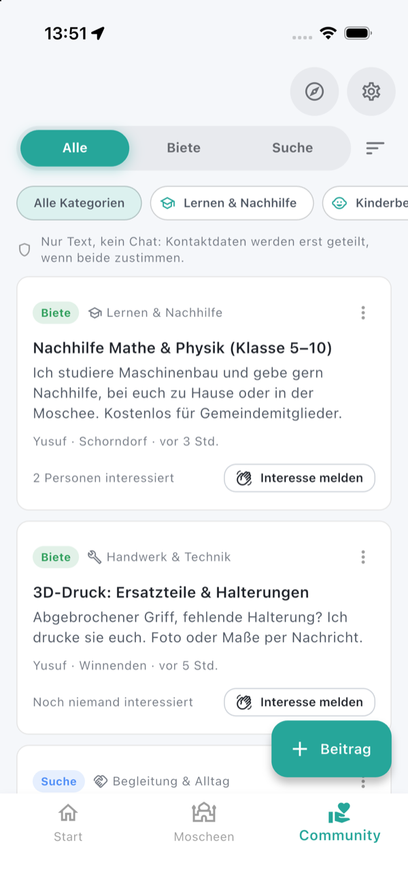
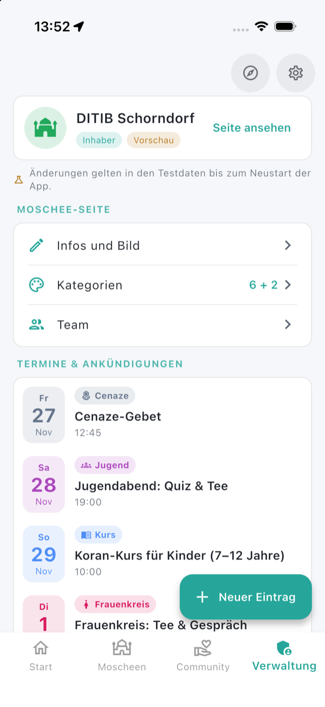
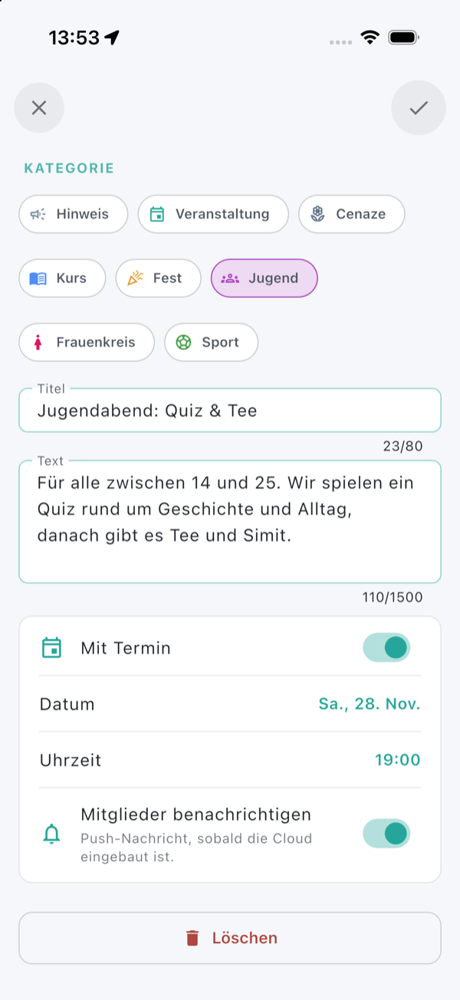
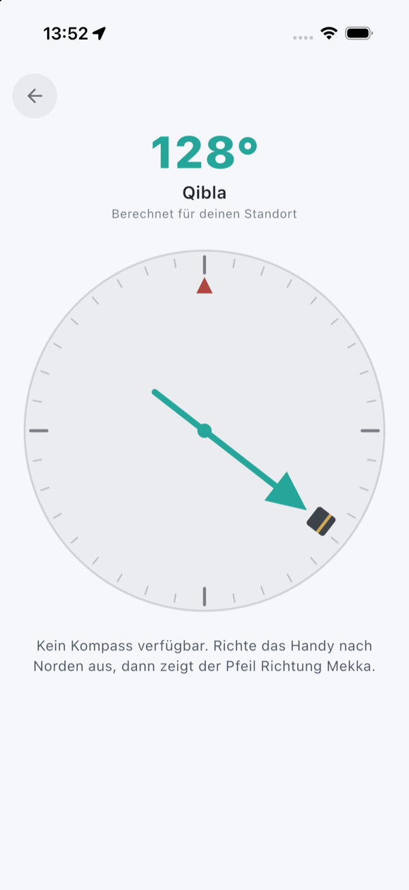
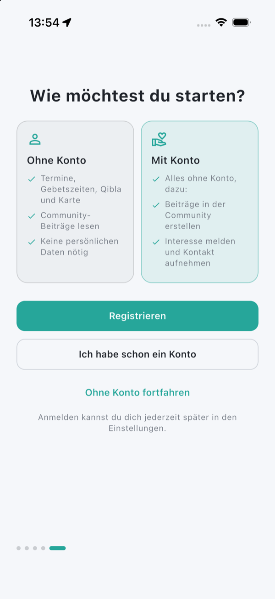
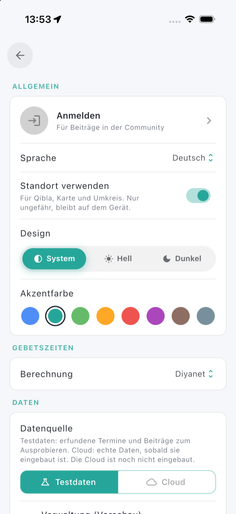
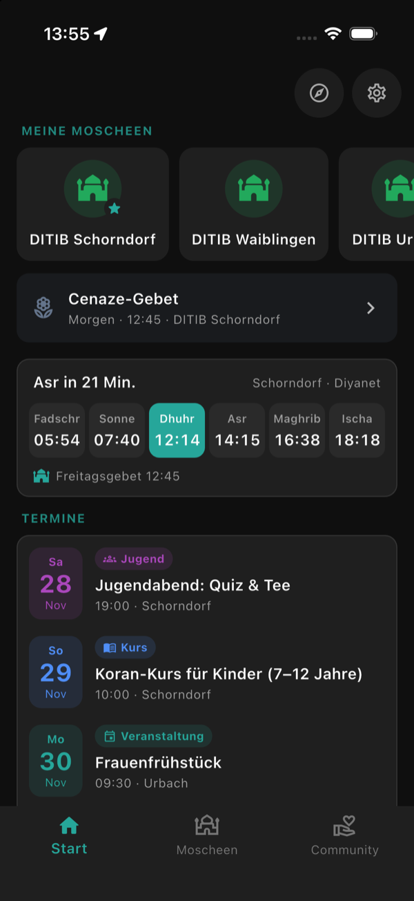

# Cemaat – Moschee-App (Arbeitstitel)

**Alle Moscheen deiner Umgebung in einer App:** Termine, Ankündigungen und
Cenaze-Gebete direkt von den Moscheen, Gebetszeiten und Qibla, eine Karte
mit allen Moscheen und eine Community, in der man sich gegenseitig hilft.

> **Erster Ansatz, kein fertiges Produkt.** Dieser klickbare Prototyp hält
> eine mögliche Richtung fest, damit wir darüber reden können. Alle Termine,
> Beiträge und Konten sind erfundene Testdaten. Planung und offene Fragen:
> [docs/README.md](docs/README.md).

## So sieht es aus

<table>
  <tr>
    <td align="center" width="25%"><br><b>Start</b><br><sub>Eigene Moscheen, Cenaze, Gebetszeiten, Termine</sub></td>
    <td align="center" width="25%"><br><b>Moschee-Seite</b><br><sub>Siegel zum Antippen, Zeiten, Termine</sub></td>
    <td align="center" width="25%"><br><b>Moscheen</b><br><sub>Karte aller 97 Orte, Regionen, Standort</sub></td>
    <td align="center" width="25%"><br><b>Community</b><br><sub>Hilfebörse: Biete/Suche, Kategorien</sub></td>
  </tr>
  <tr>
    <td align="center"><br><b>Verwaltung</b><br><sub>Für Moschee-Verantwortliche</sub></td>
    <td align="center"><br><b>Termin anlegen</b><br><sub>Eigene Kategorien mit Farbe</sub></td>
    <td align="center"><br><b>Qibla</b><br><sub>Kompass Richtung Mekka</sub></td>
    <td align="center"><br><b>Einführung</b><br><sub>Mit oder ohne Konto starten</sub></td>
  </tr>
  <tr>
    <td align="center"><br><b>Einstellungen</b><br><sub>Konto, Sprache, Standort</sub></td>
    <td align="center"><br><b>Dunkles Design</b><br><sub>Folgt dem System</sub></td>
    <td></td>
    <td></td>
  </tr>
</table>

## Kerngedanken

- **Für alle Moscheen.** Verbandsübergreifend, mit Filter nach Verband und
  Region. Start als Pilot mit DITIB-Gemeinden aus der Region.
- **Die Moschee spricht selbst.** Verifizierte Moscheen pflegen ihre Seite,
  Termine und Freitagsgebet selbst; Rollen Inhaber, Admin, Redakteur.
- **Ohne Konto nutzbar.** Lesen, Gebetszeiten, Qibla und Karte gehen sofort.
  Ein Konto braucht man nur zum Posten in der Community.
- **Datensparsam.** Religionszugehörigkeit ist besonders geschützt
  (Art. 9 DSGVO). Standort nur auf Wunsch und nur ungefähr, nie gespeichert.
- **Hilfe statt Chat.** Die Hilfebörse ist reiner Text; Kontaktdaten werden
  erst geteilt, wenn beide zustimmen. Beiträge lassen sich melden.
- **Mehrsprachig.** Deutsch, Türkisch, Englisch; weitere Sprachen später.
- **Ehrenamtlich und werbefrei.**

## Ausprobieren

Flutter installieren ([docs/SETUP.md](docs/SETUP.md)), dann:

```sh
flutter pub get
flutter gen-l10n
flutter run
```

Die App startet mit Testdaten (Moscheen der DITIB-Regionen Württemberg,
„meine Moschee“: Schorndorf). Die Verwaltungsansicht lässt sich unter
*Einstellungen → Verwaltung (Vorschau)* einschalten.

## Geplante Funktionen (MVP)

- **Moschee-Seiten** mit Verband, Adresse und Kontakt, verifiziert über einen
  einmaligen Einladungscode
- **Ankündigungen und Termine**: Cenaze-Gebete, Kurse, Feste
- **Push-Nachrichten** zu neuen Ankündigungen
- **Eigene Moschee plus Umkreis** oder eine manuelle Auswahl
- **Gebetszeiten**: lokal berechnet (`adhan`, auch Diyanet-Methode), eigene
  Zeiten der Moschee haben Vorrang
- **Qibla-Kompass**
- **Karte** der Moscheen (OpenStreetMap über `flutter_map`)
- **Admin-Bereich** für Inhaber, Admins und Redakteure
- **Sprachen**: Deutsch, Englisch, Türkisch

Danach (Phase 2): Hilfebörse nur mit Text und „Interesse melden“, dazu
Melde-Funktion und Moderation.

## Stand

Klickbarer Prototyp mit Testdaten, noch ohne Backend:

- **Start**: eigene Moschee(n) mit Bild, Cenaze-Gebete ganz oben,
  Gebetszeiten (Diyanet, lokal berechnet) mit Countdown, Termine,
  Ankündigungen, Termine der Moscheen im wählbaren Umkreis.
- **Moscheen**: Karte (OpenStreetMap) und Liste aller 97 Orte der
  DITIB-Regionen Württemberg, Farben je Region, Suche, Filter nach Region und
  Umkreis, Moschee-Seite mit „Als meine Moschee“.
- **Community**: Hilfebörse mit Biete/Suche, Kategorien, Sortierung,
  „Interesse melden“, Melden, neuer Beitrag (mit Konto).
- **Kopfleiste**: Qibla-Kompass und Einstellungen (Zahnrad) auf jedem Tab.
- **Standort** (optional, nur ungefähr): Qibla, eigene Position auf der
  Karte, Umkreis ab Standort; ohne Freigabe zählt die Hauptmoschee.
- **Siegel** auf der Moschee-Seite (Verband, Region, Verifiziert,
  Barrierefrei …) zum Antippen mit Erklärung.
- **Verwaltung** (Vorschau-Schalter in den Einstellungen): Termine und
  Ankündigungen anlegen/bearbeiten, eigene Kategorien mit Farbe und Symbol,
  Seite (Bild, Beschreibung, Freitagsgebet, Kontakt), Team mit Rollen und
  Einladungscode.
- **Einstellungen**: Konto (Testkonto, nur auf dem Gerät), Sprache
  (DE/TR/EN, Standard = System), Design (Standard = System), Akzentfarbe,
  Berechnungsmethode, Datenquelle (Testdaten/Cloud).
- **Start der App**: animierter Splash mit DITIB-Logo (mind. 1,9 s),
  Einführung zum Wischen mit der Wahl „mit / ohne Konto“.

Testdaten: `assets/testdata/test_data.json`, erzeugt von
`tool/build_test_data.py`. Regionen und Orte stammen aus der Regionenkarte
des DITIB Landesjugendverbands Württemberg; Koordinaten sind ungefähre
Ortsmitten. Termine, Texte und Beiträge sind erfunden.

Offen: Backend (Firebase oder Supabase), echte Anmeldung und Rollen, Push,
Verifizierung von Moscheen, Oberfläche für die App-Leitung (Siegel,
Moscheen freischalten), endgültiger Name und Bundle-ID.

## Struktur

```
lib/
  main.dart, app.dart          Start: Splash → Einführung → App
  core/
    theme/                     app_design.dart, theme.dart
    l10n/                      ARB-Dateien (DE = Vorlage, EN, TR)
    models/                    Mosque, Announcement, CommunityPost, AppUser
    data/                      DataRepository + Schnittstellen je Bereich
                               (Moscheen, Community, Konto) + Testdaten
    services/                  Settings, Account, Gebetszeiten, Entfernung …
  shared/                      Allgemeine Widgets, Format, Suche
  sections/
    shell/                     Tabs, Kopfleiste (Qibla, Einstellungen)
    start/                     Splash, Einführung
    auth/                      Anmelden / Registrieren
    home/                      Startseite
    mosques/                   Karte, Liste, Moschee-Seite, Termine
    community/                 Hilfebörse
    admin/                     Verwaltung einer Moschee
    prayer/                    Gebetszeiten-Karte, Qibla-Kompass
    settings/                  Einstellungen, Konto
assets/testdata/               Testdaten (JSON)
assets/branding/               DITIB-Logo für den Splash
tool/                          Testdaten- und Icon-Generator
cloud_template/                Firebase und Gruppen-Bausteine (noch nicht eingebaut)
docs/                          Konzept und Einrichtung
```

Regeln für Architektur, Theme und Texte: [CLAUDE.md](CLAUDE.md).

## Befehle

```sh
flutter pub get
flutter gen-l10n
flutter run
flutter analyze && flutter test
```
