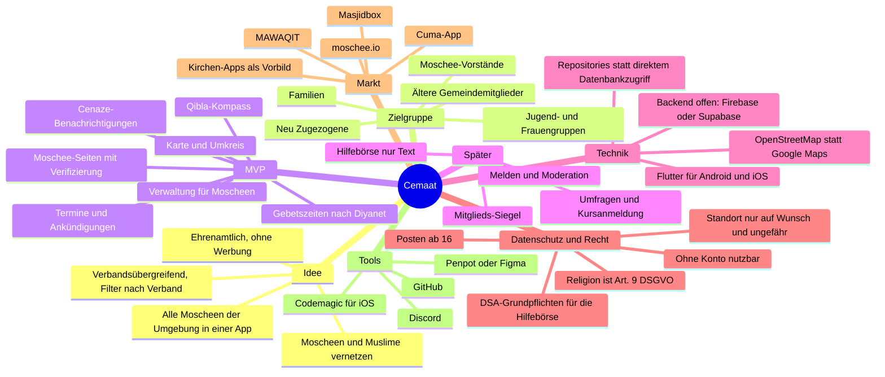

# Planung: Überblick

Diese Seite ist der Einstieg in die Planung. Die ausführliche Recherche
steht in [konzept.md](konzept.md); hier stehen die Kurzfassung als
Mindmap, die bisherigen Entscheidungen und was noch offen ist.

> Stand: erster Ansatz von Oğuzhan, zum Zeigen und Diskutieren. Noch
> nichts davon ist mit den anderen abgestimmt.

## Mindmap

## Wo steht was?

| Thema | Kurz | Ausführlich |
| --- | --- | --- |
| Kurzfazit | Lücke: verbandsübergreifend + Hilfebörse | [konzept.md §1](konzept.md#1-kurzfazit) |
| Marktrecherche | MAWAQIT als Vorbild und Konkurrenz | [§2](konzept.md#2-marktrecherche-was-es-schon-gibt) |
| Grundsatzfragen | Alle Moscheen oder nur DITIB, Verifizierung | [§3](konzept.md#3-strategische-grundsatzfragen) |
| Funktionen und Phasen | MVP, Phase 2, Phase 3, später | [§4](konzept.md#4-funktionsumfang-und-phasen) |
| Framework | Flutter | [§5](konzept.md#5-entwicklung-framework-vergleich) |
| Architektur und Backend | Repositories, Firebase vs. Supabase | [§6](konzept.md#6-architektur-und-backend) |
| Tools | GitHub, Discord, Penpot … | [§7](konzept.md#7-tools-kostenlos--open-source) |
| Recht (Hilfebörse) | DSA, Melden, Mindestalter | [§8](konzept.md#8-rechtliches-hilfebörse) |
| Personas | Hasan, Elif, Ayşe, Yusuf, Mehmet Amca | [§9](konzept.md#9-personas-entwurf) |
| App-Name | Ideen, Prüfung | [§10](konzept.md#10-app-name-erste-ideen) |

## Entscheidungen bisher

| Thema | Stand |
| --- | --- |
| Framework | Flutter (entschieden) |
| Arbeitstitel | „Cemaat“, Name noch nicht geprüft |
| Zielgruppe | Vorschlag: alle Moscheen, Pilot mit DITIB-Gemeinden |
| Backend | offen (Firebase EU oder Supabase) |
| Hilfebörse | Vorschlag: nur Text, Kontakt über „Interesse melden“, kein Chat |
| Konto | Vorschlag: App ohne Konto nutzbar, Konto erst zum Posten |

## Offene Fragen

- Alle Moscheen oder zunächst nur DITIB? Wer gibt das Logo frei?
- Firebase oder Supabase?
- Wer betreibt die App (Verein, Verband, Privatpersonen)? Davon hängen
  Impressum, Datenschutz und Apple-Gebühren ab.
- Wie läuft die Verifizierung von Moscheen konkret, und wer macht sie?
- Endgültiger Name (Stores, DPMA, Domain prüfen).

## Wie wir hier zusammenarbeiten (Vorschlag)

- **Ideen und Fragen** als GitHub-Issue (Label „Idee“ bzw. „Frage“),
  damit nichts in Chats verloren geht.
- **Mockups** in Penpot oder Figma; Link oder Export nach
  `docs/mockups/`.
- **Entscheidungen** in die Tabelle oben eintragen, mit Datum und kurzer
  Begründung.
- Der Prototyp im Repo zeigt einen möglichen Weg, er ist kein Beschluss.

## Nächste Schritte

1. Prototyp den anderen zeigen, Feedback als Issues sammeln.
2. Mit 2–3 Moscheen sprechen: Was brauchen sie wirklich? Personas prüfen.
3. Grundsatzfragen klären (Zielgruppe, Träger, Backend).
4. MVP-Screens gemeinsam in Penpot/Figma festlegen.
5. Namensideen prüfen und auswählen.
